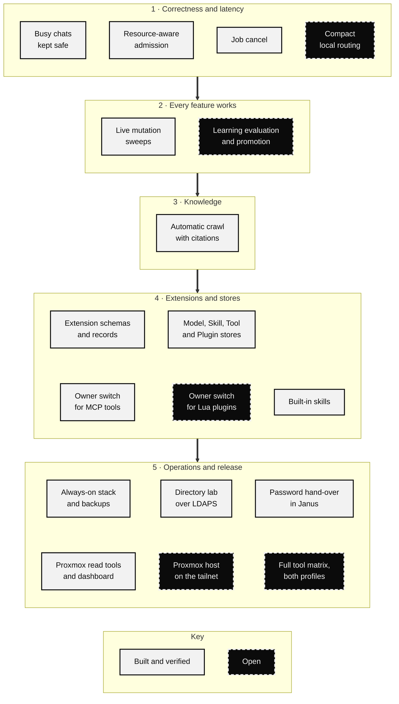

# Agentic AI Runtime

Python/FastAPI service for the Agentic Developer Hub and ITSM platform. It turns chat requests into specialist proposals, validates them against server-side policy, and executes supported tools after any required approval.

This is an evolving local-first **MVP candidate**. Model output is a proposal, never authorization. SRS 1.8 remains the authoritative MVP trust and execution baseline until the release gate is signed off.

## Features

- Hub and specialist routing for directory accounts, access, tickets, Jira, developer workspaces, knowledge, assets, and networking.
- Compact routing for selected model connections: local catalog search narrows the prompt, while the full registry still validates every proposed tool action.
- Typed tools for LDAP/Jira integrations, workspace inspection, builds/tests, and governed Git changes. Provider availability depends on configuration.
- Durable approvals that retain the exact proposed action, plus a completion outbox for reliable delivery to Phoenix.
- Authenticated WebSocket progress from the AI runtime to Phoenix, alongside durable job and approval state that can be restored after reconnecting.
- Content-free, job-bound inference observations for the Operations view: measured stage duration, scheduler wait and available token counts, with missing measurements kept explicit.
- A bounded account → Jira ticket → completion mail workflow on durable jobs, with verified account data, separate approvals, and saved continuation recovery.
- Temporary passwords are never mailed to a new account's (not yet existing) mailbox: the requester reveals them once in Janus and hands them over ([how](docs/account-ticket-workflow.md#handing-over-the-temporary-password)).
- Optional user-reviewed workflow contracts check complete operation lists, dependencies and exact target pins before dispatch for both local and outbound reasoning. Normal chat remains available; free-text submissions do not receive this completeness check.
- Local Transformers models, quantization profiles, LoRA adapters, and serialized GPU scheduling.
- Per-account model connections: compatible chat-completion APIs, including Groq; installed local profiles; and Pi/OpenCode inference adapters.
- File-based Lua adapters for model, connection, source and tool protocols. The catalog reports the resolved source digest; the host retains credentials, network access and execution policy.
- Shared provider usage queues, editable quota settings, and verified reasoning controls for supported connections.
- Validated uploads of local safetensors model folders, private reference datasets (including bounded selectable-text PDF/DOCX extraction), and reviewed JSONL training data.
- Local full-text retrieval for reference datasets, with source and trust metadata kept separate from execution authority.
- Training/evaluation infrastructure for curated datasets, candidate adapters, behavioral checks, and promotion gates.
- Advisory infrastructure drift: a saved desired topology is compared with what the read-only operations adapters observe (allow-listed containers, configured health endpoints, the configured OpenWrt router). The report is labelled simulated and never changes a device. KiCad netlists are inspected as text for connectivity findings, with no EDA tool or hardware attached.

## How the repositories fit together



```text
agenticFrontend (Nim/Karax browser)
    -> agenticBackend / itsm_backend (Phoenix API + SurrealDB)
        -> agenticaiPersonal / itsm-agent (this service)
            -> policy, approvals, tools and configured providers
```

Phoenix owns authentication, chats, and durable user-facing jobs. This service owns inference and guarded execution. The browser communicates with Phoenix only. Internal service calls use a shared token. `scripts/render_request_flow.py` regenerates the animation; a test keeps the committed file equal to its output.

## Roadmap



Light boxes are built and verified; dark dashed boxes are open. "Busy chats kept safe" covers refusing to delete a chat with an unfinished request and holding a chat's next turn while an approval is open. The trust model and the next architecture work packages are in [ARCHITECTURE.md](ARCHITECTURE.md).

## Stack

Python, FastAPI, Pydantic, PyTorch/Transformers, MCP, HTTPX, and SQLite for local approval, completion, and extension storage. LDAP and Jira are optional provider integrations; the networking adapter exposes read-only OpenWrt capabilities.

## Local setup

Use a Python environment with a PyTorch build compatible with your hardware. Local model memory requirements depend on the configured checkpoint and quantization. Model weights and provider credentials are not bundled.

```bash
python -m venv .venv
# Activate .venv using your shell's activation command.
python -m pip install -r requirements-dev.txt fastapi uvicorn
```

FastAPI and Uvicorn currently need explicit installation; they are not listed in `requirements.txt`. Dependencies are not fully locked, so a fresh environment may need version alignment.

Create a private `.env` in this repository, using [config/settings.py](config/settings.py) as the configuration reference. There is currently no tracked environment template here. Configure at least:

| Setting | Purpose |
| --- | --- |
| `PHOENIX_BASE_URL` | Backend origin, commonly `http://127.0.0.1:4000` |
| `ITSM_INTERNAL_JOB_TOKEN` | Same private token as Phoenix |
| `JOB_METRICS_ENABLED` | Optional content-free Operations observations; default `true` |
| `MODEL_PROFILES` | JSON profiles with actual model paths and runtime settings |
| `HUB_MODEL_KEY` | Hub profile; default `hub-main` |
| `DIRECTORY_BACKEND` | Explicitly choose `ldap` for directory operations |
| `TICKETING_BACKEND` | Explicitly choose `jira` for tickets |
| `ASSET_BACKEND` | Explicitly choose `sqlite` with a persistent `ASSET_SQLITE_PATH` |
| `KNOWLEDGE_BACKEND` | Explicitly choose `local` with a reviewed snapshot path and SHA256 |

Provider defaults are `unconfigured`; constructing the MCP tool server fails with a configuration error until these four provider families are explicitly selected. This prevents a missing setting from silently activating seeded demo results. `mock` remains an explicit demo/test choice; it does not verify real ITSM actions. A configured real provider never falls back to a mock on failure.

Module imports and callable-signature registration do not start the MCP server or read the deployment dotenv file. Deployment policy loads explicitly during FastAPI/MCP startup (or a requested cached-settings initialization). Signature registration uses isolated in-memory dependencies and does not execute tools or establish provider readiness. Proposal validation separately uses the deployment's configured logical repository aliases; unit tests declare those aliases explicitly.

Profiles must cover the enabled [agent definitions](subagents/agents). Configure repository/workspace mappings before using developer tools. Remote model selection does not remove the need to configure the local runtime, including the networking model.

```bash
python -m uvicorn api.app:app --host 127.0.0.1 --port 8000
```

Inspect `http://127.0.0.1:8000/ready` after startup. Run one AI process per extension/model storage root. Start Phoenix separately with matching service settings.

Optional training dependencies:

```bash
python -m pip install -r requirements-training.txt
```

## Models, harnesses, and datasets

The frontend lets signed-in users save, probe, and select their own model connections. Local models remain the default. API credentials are encrypted in the owner-scoped extension store; hosted services still require suitable account access, credentials, and quota.

Pi and OpenCode provide inference only: their native tool execution is disabled. Application policy, approvals, and ToolGateway continue to govern tools. The networking specialist keeps its existing model and receives no additional private dataset context.

The MVP focuses on completing supported ITSM actions through this guarded tool path. Explicit inference stages keep broad catalog routing local and apply separate routing/reasoning budgets to external adapters. See [compact routing and verification](docs/compact-routing.md) for current evidence and remaining acceptance work.

Reference uploads accept text/Markdown; training uploads accept reviewed JSONL. Importing training data does not start training or promote a model. Private model/dataset jobs are excluded from automatic shared training capture. See [user extensions](docs/user-extensions.md) for formats, upload limits, allowed origins, storage, and API commands.

## Tests

```bash
python -m pytest -q tests/unit
```

Real-model, GPU, provider, and container integration checks require their own configured environments. A successful connection probe confirms that request only; it is not a tool-use or model-quality evaluation.

The [tool acceptance matrix](docs/tool-acceptance-matrix.md) inventories all 67 registered tools. Existing evaluation suites cover 49 tools, with reviewed supplemental proposal cases for the other 18. Proposal coverage, approval, provider execution, and durable app-flow evidence are separate checks. Fixtures alone never count as model or tool success.

## Current boundaries

- This is an MVP candidate with model-dependent routing and argument accuracy; configured integrations are not proof of live connectivity, and release status depends on the cross-repository acceptance gate.
- Live account → Jira → mailer acceptance and complete execution coverage across local models and outbound adapters remain incomplete. WebSocket progress and passing proposal contracts do not establish successful provider actions or email delivery.
- Dataset retrieval uses local full-text search, not embeddings or an external vector database.
- PDF/DOCX ingestion extracts selectable text only in an isolated, resource-limited worker; scanned-image OCR, macros, images and attachments are not processed, and source binaries are not retained.
- The n8n/workflow surface validates manifests only. It neither runs workflows nor registers webhooks.
- The Lua Plugin Store is a read-only runtime inventory. User-authored plugin submission, review, activation, revocation and audit are not implemented; the MCP Tool Store reports registered capabilities, not provider health.
- Uploaded models reject custom executable code and pickle weights. Format admission does not guarantee inference quality or sufficient GPU memory.
- Ambiguous mutation outcomes require reconciliation; they are not automatically retried.
- Multi-worker sharing of extension/upload storage and a unified three-repository deployment are not implemented.

## More detail

- [User models, harnesses, datasets, and workflow validation](docs/user-extensions.md)
- [Extension stores, MCP catalog and Lua plugin lifecycle](docs/extension-stores.md)
- [Account → Jira ticket → mailer](docs/account-ticket-workflow.md)
- [Compact routing, inference stages, and ITSM verification](docs/compact-routing.md)
- [Cross-repository acceptance checks](docs/cross-repo-acceptance.md)
- [MVP release gate](docs/mvp-release-gate.md)
- [Architecture and trust model](ARCHITECTURE.md)
- [Security policy](SECURITY.md)
- [Capability learning architecture](docs/CAPABILITY_LEARNING_ARCHITECTURE.md)
- [Training methods](docs/training-methods.md)
